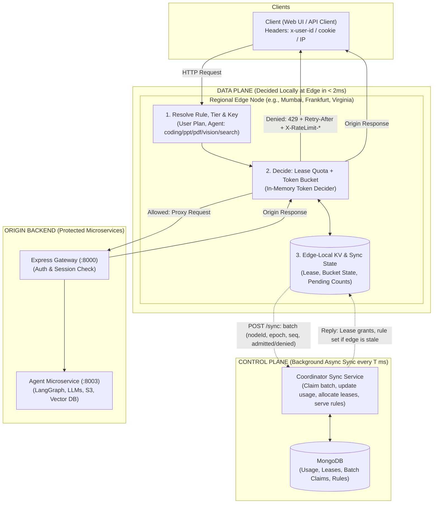

# Distributed Edge-Based Rate Limiting Architecture Plan

## 1. Executive Summary

This architecture upgrades the CortexAI system from a centralized, in-service Redis rate-limiter (`checkAgentLimit.js` inside the Agent microservice) to a **distributed, two-tier rate-limiting system** with a strict separation between:
- **Data Plane (Regional Edge Nodes):** 100% local, sub-millisecond rate-limiting decisions using an in-memory/Edge-local KV, **Lease Quotas**, and **Token Bucket** algorithms. Rejections (`429 Too Many Requests`) terminate at the edge without touching backend microservices.
- **Control Plane (Coordinator Sync Service & MongoDB):** Asynchronous background batch synchronization (`POST /sync: batch`) every $T\text{ ms}$, aggregating global agent usage, allocating dynamic lease grants, serving rule updates, and guaranteeing fault tolerance under network partitions and latency spikes.

---

## 2. End-to-End System Architecture



---

## 3. Core Concepts & Algorithmic Design

### 3.1 Data Plane: Edge Token Bucket with Leased Quota
Rather than storing a single global counter that requires a remote network call per request:
1. **Lease Grant:** The edge node requests a quota slice (lease) from the Coordinator for a short validity window $\Delta t$ (e.g., 5 seconds).
2. **Local Token Bucket:** 
   $$\text{Available Tokens} = \min\left(\text{MaxBurst}, \text{Tokens} + (\Delta \text{time} \times \text{RefillRate})\right)$$
   Tokens are strictly capped by the current **Lease Grant Balance** allocated to this node.
3. **Local Decision:**
   - If $\text{Tokens} \ge \text{Cost}(\text{Agent})$: Deduct tokens, increment local `admitted_count`, and proxy request to Origin Gateway.
   - If $\text{Tokens} < \text{Cost}(\text{Agent})$: Increment local `denied_count`, return HTTP `429 Too Many Requests` immediately with standard headers:
     - `X-RateLimit-Limit`
     - `X-RateLimit-Remaining`
     - `X-RateLimit-Reset`
     - `Retry-After`

### 3.2 Control Plane: Asynchronous Batch Synchronization
Every $T\text{ ms}$ (e.g., $T = 500\text{ ms}$):
1. **Batch Submission:** The Edge Node flushes pending metric deltas via:
   ```json
   POST /api/rate-limit/sync
   {
     "nodeId": "edge-mumbai-01",
     "region": "ap-south-1",
     "epoch": 1740000000,
     "seq": 142,
     "records": [
       { "key": "user_123:coding", "admitted": 3, "denied": 1 },
       { "key": "user_456:search", "admitted": 5, "denied": 0 }
     ],
     "leaseRequests": [
       { "key": "user_123:coding", "requestedUnits": 5 }
     ]
   }
   ```
2. **Idempotent Claim & Allocation:**
   - The Coordinator checks `(nodeId, epoch, seq)` against `BatchClaims` in MongoDB to prevent double-counting upon network retries.
   - It updates cumulative user usage and calculates new lease slices based on regional activity weights.
3. **Lease Grant Response:**
   ```json
   {
     "status": "ACK",
     "epoch": 1740000000,
     "ackSeq": 142,
     "leases": [
       { "key": "user_123:coding", "grantedUnits": 5, "leaseTtlMs": 5000 }
     ],
     "rulesUpdated": false
   }
   ```

---

## 4. Database Schema Specifications (MongoDB)

All persistent state is stored in MongoDB using existing database connections:

### 4.1 `RateLimitRule` Schema
Defines limits per agent and user subscription plan:
```javascript
{
  agent: { type: String, required: true }, // 'chat' | 'coding' | 'pdf' | 'ppt' | 'vision' | 'search'
  plan: { type: String, required: true },  // 'free' | 'starter' | 'pro'
  capacity: { type: Number, required: true }, // Max bucket size (e.g., 5)
  refillRatePerSec: { type: Number, required: true }, // Replenish rate
  cost: { type: Number, default: 1 },
  leaseMaxDurationMs: { type: Number, default: 10000 },
  version: { type: Number, default: 1 }
}
```

### 4.2 `NodeLease` Schema
Tracks dynamic leases granted to regional nodes:
```javascript
{
  key: { type: String, required: true, index: true }, // e.g. "user_<id>:coding"
  nodeId: { type: String, required: true, index: true },
  region: { type: String, required: true },
  grantedUnits: { type: Number, required: true },
  usedUnits: { type: Number, default: 0 },
  expiresAt: { type: Date, required: true, index: { expires: 60 } } // Auto-cleanup
}
```

### 4.3 `BatchClaim` Schema
Guarantees deduplication and idempotency of background sync pulses:
```javascript
{
  nodeId: { type: String, required: true },
  epoch: { type: Number, required: true },
  seq: { type: Number, required: true },
  receivedAt: { type: Date, default: Date.now, index: { expires: 3600 } }
}
// Compound unique index: { nodeId: 1, epoch: 1, seq: 1 }
```

### 4.4 `AggregateUsage` Schema
Maintains high-level user usage for billing & analytics:
```javascript
{
  userId: { type: String, required: true, index: true },
  agent: { type: String, required: true },
  periodStart: { type: Date, required: true }, // Window start (minute/hour)
  totalAdmitted: { type: Number, default: 0 },
  totalDenied: { type: Number, default: 0 }
}
```

---

## 5. Fault Tolerance & Partition Resilience Matrix

| Failure Mode | Impact on Data Plane | Mitigation & Edge Fallback Strategy |
| :--- | :--- | :--- |
| **Edge-to-Coordinator Network Partition** | Edge cannot sync counts or renew leases. | **Graceful Degradation:** Edge node consumes its remaining lease down to zero, then switches to a bounded "Emergency Local Bucket" (e.g., allowing at most 1 minimal fallback request/sec for health/chat) while denying high-cost agents (`coding`, `ppt`, `pdf`). System never crashes. |
| **Lost Sync Reply (Dropped Packets)** | Edge does not receive ACK/lease reply. | Edge resends the batch with identical `epoch` and `seq`. Coordinator detects duplicate in `BatchClaim`, discards duplicate metrics, and re-emits the lease reply. |
| **Coordinator / MongoDB Down** | Central usage database unavailable. | Data plane remains operational for all valid leases. When leases expire, edge nodes enter autonomous degraded mode, returning `429` with extended `Retry-After` rather than crashing origin services. |
| **Edge Node Cold Start** | Node has empty local KV. | Edge performs synchronous `first-contact` handshake on boot to download rules and initial quota leases. If coordinator unreachable, falls back to local static defaults. |

---

## 6. Implementation Plan & File Structure

### Phase 1: Models & Coordinator Sync Service (`backend/services/rate-limiter`)
Create a dedicated microservice (or module) for the control plane:
- `backend/services/rate-limiter/models/rule.model.js`
- `backend/services/rate-limiter/models/lease.model.js`
- `backend/services/rate-limiter/models/batchClaim.model.js`
- `backend/services/rate-limiter/models/usage.model.js`
- `backend/services/rate-limiter/controllers/sync.controller.js`
- `backend/services/rate-limiter/services/leaseAllocator.js`
- `backend/services/rate-limiter/index.js` (runs on port `:8005` or integrated into gateway)

### Phase 2: Regional Edge Node Middleware / Proxy (`backend/edge-node`)
Can run as a standalone Edge Reverse Proxy (or deployable to Cloudflare Workers / Node Edge container):
- `backend/edge-node/kv/localStore.js` (Fast In-memory LRU KV store for leases & bucket states)
- `backend/edge-node/limiter/tokenBucket.js` (Local Token Bucket logic with lease bounds)
- `backend/edge-node/client/syncClient.js` (Background worker running every $T = 500\text{ ms}$, flushing queues to Coordinator)
- `backend/edge-node/middleware/rateLimitProxy.js` (Inspects `/api/agent/chat`, resolves key/plan/agent, validates bucket, proxies or emits 429)
- `backend/edge-node/index.js` (Listening port `:7999`, routing traffic to Gateway `:8000`)

### Phase 3: Integration & Deprecation of Legacy In-Service Limiter
- Update `frontend/utils/axios.js` / Vite config to point requests through the Edge Proxy (`:7999`).
- Update `backend/services/agent/agents/*.js`:
  - Retain `checkAgentLimit.js` as an optional secondary safety net (Defense-in-Depth) or retire it in favor of edge headers.
- Pass resolved rate limit headers through to the frontend UI so users can see remaining requests and live countdown timers in `ChatInput.jsx`.

### Phase 4: Chaos & Fault-Injection Testing Suite
- Add script `backend/test/fault-injection.js` to simulate:
  1. High concurrency bursts on `coding` and `vision` agents.
  2. Edge-to-Coordinator latency injection (500ms - 2000ms delay).
  3. Dropped network packets / synthetic HTTP 500 on `/sync`.
  4. Verification of sub-2ms rejection latency on the edge node.

---

## 7. Next Steps

With this architecture blueprint documented, execution can proceed systematically:
1. Initialize the rate-limiter data models in MongoDB.
2. Build the Coordinator Sync controller and lease distribution logic.
3. Build the Edge-local Token Bucket and async Sync Client.
4. Wire the edge proxy in front of the Gateway and run end-to-end load & chaos verification.
